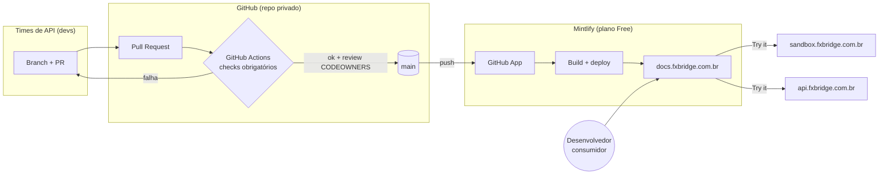
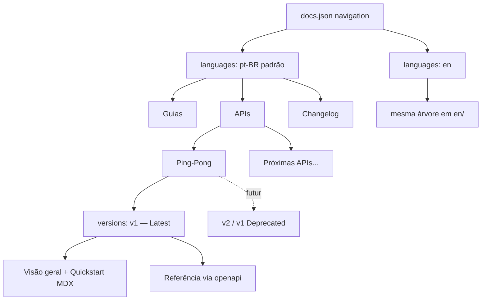
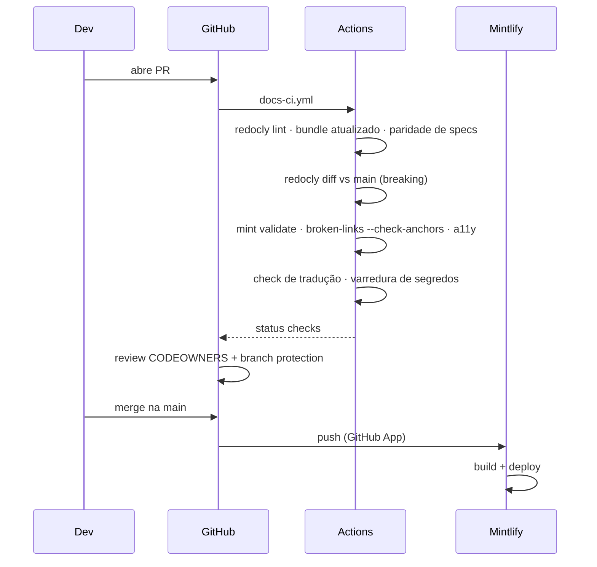

# Portal de documentação de APIs FXBridge com Mintlify

## Contexto

Projetar e implementar um portal de documentação de APIs no **Mintlify** com:
- o Git (GitHub) como fonte única;
- publicação por PR;
- tema claro e escuro;
- pt-BR e en;
- versões de API;
- referência gerada a partir de OpenAPI;
- escala de 6 a 20 APIs.

A API **Ping-Pong** valida a solução de ponta a ponta. O repositório começa vazio, sem nenhum commit.

O plano consolida as **Fases 1 a 5** (Discovery, validação tecnológica, arquitetura, especificação e planejamento). A **Fase 6** (implementação) só começa com a aprovação deste plano e segue etapa por etapa, com pausa nos gates indicados.

**Legenda das fontes:** ✅ confirmado na documentação oficial · 💡 recomendação técnica · ❓ hipótese a validar · 🟢 decisão aprovada pelo usuário.



## 1. Especificação funcional e não funcional (resumo)

| Req. | Atendimento | Fonte |
|---|---|---|
| RF01 Temas | `appearance.default: "system"` segue o sistema operacional. O botão de alternância fica visível (`strict: false`). Logo e cores são definidos para claro e escuro. | ✅ |
| RF02 i18n | `navigation.languages`: pt-BR é o padrão e fica na raiz; en fica em `en/`. Tradução manual. | ✅ / 🟢 DEC-006, DEC-010 |
| RF03 GitOps | GitHub App com deploy automático a cada push na `main`. PRs com checks obrigatórios. | ✅ / 🟢 DEC-002 |
| RF05 Versões | Versão no path (`/v1`). Seletor de versão por API. Tag "Deprecated" no seletor. | ✅ `versions[].tag` / 🟢 |
| RF06 Boas práticas | Guias transversais, erros em RFC 9457, exemplos multilinguagem gerados pelo playground. | 💡 |
| RF07 Ping-Pong | Contrato na seção 10. | 🟢 |
| RF08 Escala | Monorepo com uma pasta por API e componentes compartilhados. | 🟢 DEC-005 |
| RF09 Publicação | Portal 100% público no Free, em domínio próprio. | 🟢 DEC-001, DEC-007, DEC-008 |
| RNF Qualidade | Rodam no CI: `mint validate`, `mint broken-links`, `mint a11y`, `redocly lint` e paridade dos specs. | ✅ / 💡 |
| RNF Segurança | Repo privado, CODEOWNERS, branch protection, varredura de segredos e nenhum spec restrito no repo. | 💡 |
| RNF Rastreabilidade | Git, PR obrigatório, changelog com `<Update>`. | ✅ / 💡 |

## 2. Matriz de decisões

| ID | Decisão | Alternativas | Recomendação | Status |
|---|---|---|---|---|
| DEC-001 | Visibilidade | Pública / Restrita / Mista | MVP público | 🟢 Aprovada (revista: era "Mista") |
| DEC-002 | Plataforma Git | GitHub / GitLab / outra | — | 🟢 GitHub |
| DEC-003 | Origem dos contratos | Design-first / Code-first / Híbrido | Design-first | 🟢 Aprovada |
| DEC-004 | Organização multi-API | Um portal / um portal por produto | Um portal, idioma → API → versão | 🟢 Aprovada (aninhamento ❓ validado na E1) |
| DEC-005 | Local dos contratos | Monorepo / repo por API + sync | Monorepo | 🟢 Aprovada |
| DEC-006 | Idioma-fonte | pt-BR / en | pt-BR | 🟢 Aprovada |
| DEC-007 | Orçamento | Free / pago | Free | 🟢 Aprovada |
| DEC-008 | Domínio | Subdomínio / subpath / padrão | `docs.fxbridge.com.br` | 🟢 Aprovada |
| DEC-009 | Substituto do preview de PR | CI + `mint dev` / plano pago | CI + `mint dev` | 🟢 Aprovada |
| DEC-010 | Tradução | Manual + check / IA (Pro) | Manual + check | 🟢 Aprovada |
| DEC-011 | Specs restritos | Fora do repo / no repo | Fora do repo | 🟢 Aprovada |
| DEC-012 | Autores | Devs / time de docs / misto | Devs dos times | 🟢 Aprovada |
| DEC-013 | Versionamento de API | Path / header | Path `/vN` | 🟢 Aprovada |
| DEC-014 | Docs de versões antigas | Seletor / só versões ativas | Seletor no portal | 🟢 Aprovada |
| DEC-015 | Lint e bundle de OpenAPI | Redocly CLI / Spectral | Redocly CLI (`lint`, `bundle`, `diff`) | Pendente (aprovado junto com o plano) |
| DEC-016 a DEC-020 | Contrato Ping-Pong | — | Seção 10 | 🟢 Aprovadas |
| DEC-021 | Idioma do spec | Único en / único pt-BR / um por idioma | Um por idioma, com check de paridade | 🟢 Aprovada |
| DEC-022 | Slugs e nomes de arquivo | Em inglês nos dois idiomas / traduzidos | Em inglês nos dois idiomas, porque o Mintlify exige nomes de arquivo idênticos entre idiomas (✅) | Pendente (aprovado junto com o plano) |
| DEC-023 | Breaking change no CI | Bloquear / avisar | Bloquear o PR se `redocly diff` achar breaking change na mesma `/vN`, salvo com o label `breaking-approved` | Pendente (aprovado junto com o plano) |
| DEC-024 | Prazo de depreciação | 6 / 12 meses | 12 meses entre `deprecated` e `sunset` | 🟢 Aprovada |
| DEC-025 | Rigor do check de tradução | Falhar / avisar | Falhar se faltar a página en correspondente; avisar se a en estiver mais antiga que a pt-BR | Pendente (aprovado junto com o plano) |

## 3. Arquitetura proposta

- **Repositório:** monorepo privado no GitHub. Ele é a fonte única de conteúdo MDX, contratos OpenAPI e configuração (`docs.json`).
- **Publicação:** o GitHub App do Mintlify faz o deploy em cada push na `main` (✅). Não há previews no Free (✅). Previews seriam públicos de qualquer forma (✅).
- **Qualidade:** o GitHub Actions bloqueia o merge quando algum check falha (DEC-009).
- **Navegação** (❓ o aninhamento é validado na E1; ver seção 8):



## 4. Estrutura de diretórios

```
/
├── AGENTS.md                      # fonte única de instruções (CLAUDE.md importa)
├── CLAUDE.md                      # @AGENTS.md
├── README.md                      # como contribuir, rodar mint dev, fluxo de PR
├── docs.json                      # configuração Mintlify
├── redocly.yaml                   # ruleset OpenAPI da empresa
├── package.json                   # scripts: dev, lint, bundle, check
├── .specs/                        # planos (versionado)
├── .github/
│   ├── CODEOWNERS                 # /apis/pingpong/ @time-pingpong ...
│   ├── pull_request_template.md
│   └── workflows/docs-ci.yml
├── contracts/                     # FONTE dos contratos (multi-file permitido)
│   ├── _shared/                   # components comuns: ProblemDetails, headers
│   └── pingpong/v1/{pt-BR,en}/openapi.yaml
├── openapi/                       # BUNDLE gerado (arquivo único, commitado)
│   └── pingpong/v1/{pt-BR,en}.yaml
├── scripts/                       # check de paridade e de tradução
├── snippets/                      # trechos MDX reutilizáveis
├── images/  logo/
├── index.mdx                      # pt-BR (padrão na raiz)
├── guides/                        # autenticação, erros, ambientes, versionamento,
│                                  # rate-limit, idempotência, paginação
├── apis/pingpong/v1/{overview,quickstart}.mdx
├── changelog.mdx
└── en/                            # espelho com nomes de arquivo idênticos
    ├── index.mdx  guides/  apis/  changelog.mdx
```

**Por que existe `contracts/` separado de `openapi/`:** o Mintlify só resolve `$ref` dentro do mesmo arquivo (✅). Os autores escrevem em `contracts/`, reaproveitando `_shared/`. O comando `npm run bundle` gera `openapi/`, que é o que o `docs.json` referencia. O CI falha se o bundle commitado não bater com a fonte.

## 5. Versionamento

- **APIs:** a versão major vai no path (`/v1`), e `info.version` segue SemVer. Mudança compatível mantém a `/vN`; breaking change cria `/v(N+1)` (DEC-023).
- **Depreciação:** usar `deprecated: true` no OpenAPI e a tag "Deprecated" no seletor (✅). 💡 Os headers `Deprecation` (RFC 9745) e `Sunset` (RFC 8594) devem ser enviados pela API, o que é responsabilidade do time da API. O prazo fica na DEC-024.
- **Documentação:** histórico no Git, PRs com template e `changelog.mdx` com `<Update>` e tags por API (✅). O RSS só funciona em docs públicas (✅), o que é compatível com a DEC-001.

## 6. Internacionalização

- pt-BR na raiz e en em `en/`, com nomes de arquivo idênticos (✅).
- Um spec por idioma (DEC-021). `scripts/` compara os dois specs depois de remover os campos de texto (`summary`, `description`, `title`, `example*`). Se a estrutura divergir, o CI falha.
- Check de tradução (DEC-025). O check de desatualização compara a data do último commit da página pt-BR com a da en.
- ❓ O redirecionamento pelo idioma do navegador existe (✅), mas há uma limitação para sites com autenticação. Não se aplica ao MVP.

## 7. GitOps e CI/CD



- **Branch protection na `main`:** PR obrigatório, 1 aprovação de CODEOWNERS e checks obrigatórios. O app não consegue dar push em branch protegida (✅), então o editor web do Mintlify fica fora do fluxo. Edições só por PR.
- **Rollback:** `git revert` do PR, que dispara um novo deploy. ❓ O rollback pelo dashboard não está documentado.
- **Node:** ≥ 20.17, exceto a versão 25 (✅). Pacote `mint`, não o legado `mintlify` (✅).

## 8. Organização multi-API

- Uma pasta por API em `contracts/`, `openapi/` e `apis/`, e uma linha no CODEOWNERS por API.
- Padrões comuns ficam em `contracts/_shared` (Problem Details e headers) e em `snippets/` (blocos MDX).
- Guias transversais em `guides/`, escritos uma única vez.
- **Gate da E1:** se `languages → products/dropdown → versions` não passar no `mint validate`, o plano B é usar grupos `v1` e `v2` dentro de cada API. Nesse caso volto a você antes de seguir.

## 9. Padrão OpenAPI (ruleset em `redocly.yaml`)

- OpenAPI **3.1** (o Mintlify aceita 3.0, 3.1 e 3.2 ✅).
- `servers` com descrição de Sandbox e Produção.
- `operationId` obrigatório; `tags` obrigatórias e declaradas.
- Toda resposta com `description` e exemplo.
- Erros 4xx e 5xx com `application/problem+json` (RFC 9457) via `$ref` para `_shared`.
- Nomes de campos em `camelCase`; datas em ISO 8601 UTC.
- Nenhum exemplo com dado real ou credencial.

## 10. Contrato Ping-Pong (aprovado)

| Item | Valor |
|---|---|
| Servers | Sandbox `https://sandbox.fxbridge.com.br` · Produção `https://api.fxbridge.com.br` |
| Endpoint | `GET /v1/ping` |
| Autenticação | Nenhuma |
| 200 | `application/json` → `{ "message": "pong", "timestamp": "2026-11-19T08:57:35Z" }` (`message`: string, enum `pong`; `timestamp`: string date-time UTC) |
| Erros | `application/problem+json` (RFC 9457), no mínimo 500 e 503 documentados |
| Headers | Nenhum header customizado obrigatório no MVP |
| Pendência externa | CORS liberado para `https://docs.fxbridge.com.br` nos dois hosts, para o "Try it" funcionar |

## 11. Segurança e publicação

- 🔴 Sem autenticação, **todo JSON e YAML do repo é servido publicamente**, inclusive specs fora da navegação (✅). Regra: o repo só contém contratos públicos (DEC-011). Um check no CI bloqueia os sufixos `*internal*` e `*private*`.
- Repo privado, GitHub App restrito a esse único repo (✅), varredura de segredos (gitleaks) no CI e exemplos fictícios.
- Domínio `docs.fxbridge.com.br` configurado com dois TXT de verificação e depois um CNAME para `cname.mintlify.builders`; certificado Let's Encrypt automático. Se houver registro CAA, ele precisa autorizar `letsencrypt.org` (✅). Configurar `seo.metatags.canonical`.

## 12. Custos, planos e limitações

| Plano | Preço | Relevante para nós |
|---|---|---|
| **Free (adotado)** | US$ 0 | 5 editores, domínio próprio, Git sync e playground. **Não tem** previews, analytics, assistente de IA nem tradução por IA. A única autenticação é a Private auth. |
| Pro | US$ 450/mês (anual) ou US$ 540 (mensal) | Previews, senha compartilhada, tradução por IA e analytics |
| Enterprise | Sob consulta | OAuth, JWT, e-mail, grupos e multi-repo |

- ❓ Não está documentado se contribuidores pelo Git ocupam as 5 vagas de editor (a hipótese é que não). Confirmar na E5.
- **Gatilho de reavaliação:** a primeira API restrita ou a necessidade de analytics.

Fonte: [mintlify.com/pricing](https://www.mintlify.com/pricing).

## 13. Plano de implementação incremental

Os itens marcados com 👤 são ações externas, feitas por você ou com sua confirmação: criar a conta, instalar o app, configurar DNS e branch protection.

| Etapa | Objetivo | Entregas | Critério de aceite |
|---|---|---|---|
| E0 Fundação | Base do repo | `AGENTS.md`, `CLAUDE.md`, `README`, `.gitignore`, `package.json`, `CODEOWNERS`, template de PR | Arquivos revisados; `npm install` ok |
| E1 PoC de navegação (**gate**) | Eliminar o risco C4 | `docs.json` mínimo com idiomas, API e versão, tema `system` | `mint validate` sem erros; `mint dev` mostra seletor de idioma, de versão e o botão claro/escuro. Se falhar, volto a você com o plano B |
| E2 Contrato | Ping-Pong e padrão OpenAPI | `redocly.yaml`, `contracts/_shared`, specs pt-BR e en, bundle | `redocly lint` ok; script de paridade ok; bundle idêntico ao commitado |
| E3 Conteúdo | Portal navegável | Home, quickstart, guias transversais, referência, changelog, nos dois idiomas | `mint validate`, `broken-links --check-anchors` e `a11y` ok; DEC-024 decidida |
| E4 CI | Automação dos checks | `docs-ci.yml`, scripts de tradução e paridade, gitleaks | PR de teste com erro proposital falha; PR correto passa |
| E5 Publicação 👤 | Site no ar | Conta Mintlify, GitHub App, DNS, branch protection | `https://docs.fxbridge.com.br` com TLS válido; deploy automático após merge |
| E6 Ponta a ponta | Validação final | PR real, revert, "Try it" | Mudança chega ao ar após o merge; revert restaura; "Try it" responde 200 no Sandbox (depende de CORS) |

## 14. Verificação

- **Local:** `npm run check`, que encadeia `redocly lint`, a verificação de bundle, a paridade, `mint validate`, `mint broken-links --check-anchors` e `mint a11y`. Depois, `mint dev` para inspecionar visualmente os dois temas, os dois idiomas e o seletor de versão.
- **CI:** um PR de teste que quebra um link e o spec precisa falhar; o PR corrigido precisa passar.
- **Produção:** acessar o portal em pt-BR e en, nos modos claro, escuro e sistema; executar o "Try it" no Sandbox; validar o RSS do changelog.

## Referências

[Pricing](https://www.mintlify.com/pricing) · [Authentication](https://www.mintlify.com/docs/deploy/authentication-setup) · [Navigation](https://www.mintlify.com/docs/navigation) · [i18n](https://www.mintlify.com/docs/guides/internationalization) · [GitHub](https://www.mintlify.com/docs/deploy/github) · [Preview deployments](https://www.mintlify.com/docs/deploy/preview-deployments) · [OpenAPI setup](https://www.mintlify.com/docs/api-playground/openapi-setup) · [Custom domain](https://www.mintlify.com/docs/customize/custom-domain) · [CLI](https://www.mintlify.com/docs/cli/commands) · [Changelogs](https://www.mintlify.com/docs/create/changelogs) · [Appearance](https://www.mintlify.com/docs/organize/settings-appearance) · [Redocly CLI](https://redocly.com/docs/cli/commands) · [RFC 9457](https://www.rfc-editor.org/rfc/rfc9457) · [OpenAPI 3.1](https://spec.openapis.org/oas/v3.1.0)
