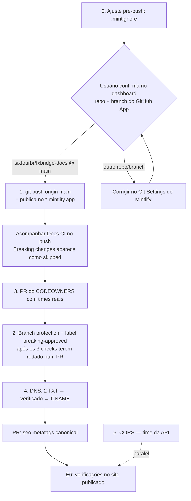

# E5 e E6: publicação e validação ponta a ponta do portal FXBridge

## Contexto

O plano-mãe ([pasted-content-id-1706-contexto-immutable-duckling.md](pasted-content-id-1706-contexto-immutable-duckling.md))
tem E0 a E4 concluídas e a identidade visual aplicada. Falta pôr o site no ar (E5) e validar o
fluxo completo em produção (E6).

Estado do Git conferido nesta sessão:

- `main` local em `f94c369` (merge que trouxe o histórico do repositório de planejamento para cima
  do `Initial commit` do Starter Kit + `4d0ad3d`, que removeu o template).
- `origin/main` em `dd9a8ad` (Initial commit do Starter Kit). São 13 commits à frente; o push é
  fast-forward, sem force.
- Remote: `git@sixfourbr:sixfourbr/fxbridge-docs.git`.
- `.github/CODEOWNERS` só tem placeholders comentados — hoje não tem efeito.

Toda ação externa (push, label, branch protection, API do GitHub/Mintlify) espera confirmação
explícita do usuário, passo a passo.

## Achados da leitura (antes de executar)

1. **`.redocly.lint-ignore.yaml` seria publicado.** O Mintlify ignora por padrão só `.git`,
   `.github`, `.claude`, `.agents`, `.idea`, `.vscode`, `.cursor`, `node_modules` e alguns
   `README/LICENSE/CHANGELOG/CONTRIBUTING.md` — não todos os dotfiles
   ([mintignore](https://www.mintlify.com/docs/organize/mintignore)). Esse YAML não está no
   `.mintignore`. Não tem segredo, mas é arquivo interno. Proposta: adicioná-lo ao `.mintignore`
   num commit **antes** do push, porque o push na `main` já publica.
   `.github/workflows/docs-ci.yml` fica coberto pelo padrão `.github`.
2. **Ordem entre passos 2 e 3.** O GitHub só permite marcar um check como obrigatório se ele
   tiver concluído no repositório nos últimos 7 dias
   ([troubleshooting required status checks](https://docs.github.com/en/pull-requests/collaborating-with-pull-requests/collaborating-on-repositories-with-code-quality-features/troubleshooting-required-status-checks)).
   O job "Breaking changes" só roda em `pull_request`; no push ele fica *skipped*. Por isso o PR
   do CODEOWNERS (passo 3) vem antes de ligar a branch protection (passo 2): ele faz os três
   checks rodarem e também ativa os donos que a regra "Require review from Code Owners" precisa.
3. **Label `breaking-approved` = bypass por design.** Job pulado por condicional reporta
   "Success" e satisfaz o check obrigatório (mesma fonte). Restringir quem aplica labels é o
   controle real (permissão de triage/write).
4. **Plano do GitHub da org.** A documentação de branches protegidas não confirma o suporte em
   repositório privado de organização no plano Free
   ([about protected branches](https://docs.github.com/en/repositories/configuring-branches-and-merges-in-your-repository/managing-protected-branches/about-protected-branches)).
   Confirmar o plano da org `sixfourbr` antes do passo 2.
5. **Canonical confirmado.** `seo.metatags.canonical` no `docs.json` é documentado na página de
   domínio próprio ([custom domain](https://www.mintlify.com/docs/customize/custom-domain)).
   Entra por PR só depois do domínio verificado, para não canonizar para um host que ainda não
   responde.

## E5 — Publicação

### Passo 0 — Ajuste pré-push (local)

- Adicionar `.redocly.lint-ignore.yaml` ao [.mintignore](../.mintignore), na seção
  "Ferramentas e automação".
- `npm run check` e commit `chore(portal): ignorar excecoes de lint na publicacao`.

### Passo 1 — GitHub App e push 👤

- Usuário abre **Dashboard → Git Settings** e confirma organização, repositório e branch
  (`sixfourbr/fxbridge-docs`, `main`, sem subdiretório). A página permite trocar os três
  ([GitHub](https://www.mintlify.com/docs/deploy/github)). Recomendado: app instalado com
  "Only select repositories".
- Com o ok: `git push origin main` (fast-forward).
- Acompanhar com `gh run watch` o run "Docs CI" do push: esperado "Portal e contratos" e
  "Varredura de segredos" verdes, "Breaking changes" *skipped*.
- Conferir no dashboard que o deploy saiu e abrir o `*.mintlify.app`.

### Passo 3 — CODEOWNERS por PR 👤 (usuário informa os times)

- Branch `chore/codeowners`, substituir placeholders em [.github/CODEOWNERS](../.github/CODEOWNERS)
  pelos times reais e remover o aviso "PENDENTE".
- Confirmar que os times existem e têm permissão de escrita no repo (CODEOWNERS sem write é
  ignorado).
- Abrir PR com `gh pr create` (com ok) e confirmar os três checks verdes.

### Passo 2 — Branch protection e label 👤

- Com o ok e após o PR do passo 3 ter rodado: proteger `main` com PR obrigatório, 1 aprovação,
  "Require review from Code Owners", e os checks "Portal e contratos", "Breaking changes" e
  "Varredura de segredos" como obrigatórios ("require branches to be up to date" ligado).
- Criar o label `breaking-approved` (`gh label create`).
- Pode ser via UI pelo usuário ou via `gh api` por mim — a escolha é do usuário.
- Merge do PR do CODEOWNERS (já sob a proteção, como primeiro teste).

### Passo 4 — Domínio `docs.fxbridge.com.br` 👤

1. Dashboard → Custom domain → adicionar `docs.fxbridge.com.br`.
2. Usuário cria os dois TXT mostrados: `_acme-challenge.docs.fxbridge.com.br` e
   `_cf-custom-hostname.docs.fxbridge.com.br`. Eu verifico com `dig TXT`.
3. **Só depois** dos dois "verified" no dashboard: CNAME `docs` → `cname.mintlify.builders`.
   Se houver CAA em `fxbridge.com.br`, incluir `0 issue "letsencrypt.org"` (verifico com
   `dig CAA`).
4. Eu verifico `dig CNAME` e o TLS com `curl -vI https://docs.fxbridge.com.br` (pode levar
   algumas horas; raramente até 24 h).
5. PR com `"seo": {"metatags": {"canonical": "https://docs.fxbridge.com.br"}}` no
   [docs.json](../docs.json).

### Passo 5 — CORS (só acompanhar)

- Time da API libera a origem `https://docs.fxbridge.com.br` em `sandbox.fxbridge.com.br` e
  `api.fxbridge.com.br`. Eu verifico com um preflight `curl -X OPTIONS` com `Origin` e
  `Access-Control-Request-Method: GET` em `/v1/ping`.

## E6 — Validação ponta a ponta

| Verificação | Como |
|---|---|
| Arquivos internos dão 404 | `curl -o /dev/null -w '%{http_code}'` em `/.specs/<plano>.md`, `/AGENTS.md`, `/package.json`, `/redocly.yaml`, `/.redocly.lint-ignore.yaml`, `/contracts/pingpong/v1/en/openapi.yaml`; e 200 em `/openapi/pingpong/v1/en.json` (controle) |
| Seletores e temas | Playwright: seletor pt-BR/en, seletor de versão, claro/escuro/sistema (`emulate_media`) |
| RSS do changelog | `curl` em `/changelog/rss.xml` → 200 e XML válido |
| PR bloqueado | Branch de teste com link quebrado + breaking change no contrato → checks vermelhos e merge bloqueado; corrigir → verdes. Fechar sem merge |
| Revert | PR com mudança visível → merge → conferir no ar → PR de `git revert` → conferir que voltou |
| "Experimentar" | Playwright em `GET /v1/ping`, servidor Sandbox → 200 (depende do CORS) |

## Respostas do usuário (2026-11-19)

- GitHub App conectado a `sixfourbr/fxbridge-docs` @ `main` — confirmado no dashboard.
- Passo 0 aprovado: incluir `.redocly.lint-ignore.yaml` no `.mintignore` antes do push.
- Org `sixfourbr` em plano Team ou Enterprise: branch protection disponível (achado 4 resolvido).

## Riscos e pendências

- Contribuidores via Git ocupam vaga de editor no Free? Não documentado (❓ do plano-mãe).
  Verificar no dashboard após o push.
- PRs de teste da E6 e o PR de revert ficam no histórico — usar títulos `test(portal): ...`.
- Status do plano-mãe e deste plano só mudam via `/plan-status`, quando o usuário pedir.
